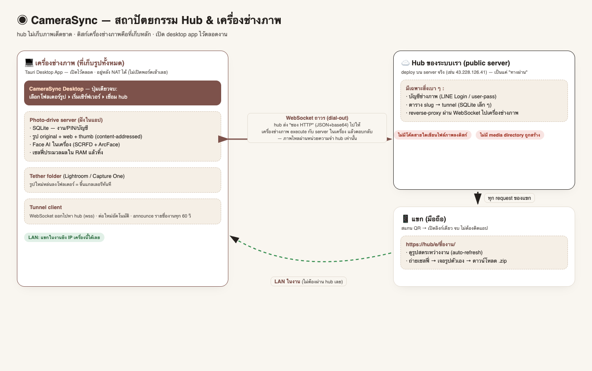

# CameraSync — Wedding Photo Drive



**Drive รูปงานแต่งหนึ่งงานหนึ่งแหล่ง**: sync จากเครื่องช่างภาพแบบใกล้เรียลไทม์ → แขกสแกน QR ดูรูปสดระหว่างงาน → ถ่ายเซลฟี่เพื่อค้นหารูปของตัวเอง (AI face search)

## Hub กับเครื่องช่างภาพ "คุยกันยังไง"

คำตอบสั้น: **WebSocket ถาวรแบบ dial-out + ส่งต่อเป็น "ซอง HTTP"** (ดูภาพประกอบด้านบน)

1. เครื่องช่างภาพ (desktop app) เป็นฝ่าย **เปิด WebSocket ออกไปหา hub ตลอดเวลา** (`wss://hub/r/connect/u-<user>?token=…`) — อยู่หลัง NAT/ไม่เปิดพอร์ตเข้าเลยก็ใช้ได้ หลุดแล้วต่อใหม่เองทุก 2 วินาที
2. ทุกครั้งที่ต่อสำเร็จ เครื่องช่างภาพ **announce รายชื่องาน (slug)** ให้ hub (ทุก 60 วิ) → hub เก็บตาราง `slug → tunnel`
3. เมื่อแขกเปิด `https://hub/e/{slug}/` hub จะแปลง request เป็น JSON+base64 (`method/path/headers/body`) **ยิงผ่าน WebSocket ไปให้เครื่องช่างภาพ** → เครื่องนั้นเรียก server ในตัว (`localhost:8080`) แล้วตอบกลับมา → hub ส่งต่อให้แขก
4. **ภาพไหลผ่าน RAM ของ hub เท่านั้น** — ไม่มีไฟล์ภาพถูกเขียนลงดิสก์ hub เด็ดขาด (hub ยังไม่สร้าง media directory ด้วยซ้ำ)
5. ในงานที่มี Wi-Fi แขกสามารถเข้า **LAN ตรง** ที่ IP เครื่องช่างภาพได้เลยโดยไม่ผ่าน hub (เน็ตนอกล่มก็ยังเดิน)

## โมเดลใหม่: Hub-and-Spoke (hub ไม่เก็บภาพเด็ดขาด)

```
ช่างภาพรัน desktop app (Tauri) ──auth──▶ Hub ของระบบเรา (deploy บน server)
        │                                     │
   รูป+DB+face AI อยู่เครื่องช่างภาพ            │ ดึงภาพ realtime ผ่าน tunnel
   (disk ตัวเอง เปิดไว้ตลอด)                    │ ไม่มีไฟล์ภาพถูกเขียนบน hub เลย
        ▲                                     ▼
        └────────── แขกเปิด hub/e/ชื่องาน ◀──────┘
```

- **เครื่องช่างภาพ**: desktop app embed server ทั้งตัว (SQLite + รูป + โมเดล) + tunnel client
- **Hub**: เก็บแค่บัญชี + ตาราง slug→tunnel ทุก request ของแขกถูกส่งต่อไปเครื่องช่างภาพแบบ realtime — **zero photo storage by design** (ไม่มีโค้ดสายใดเขียน bytes ภาพลงดิสก์ แม้ media directory ยังไม่ถูกสร้าง)
- แขกได้ลิงก์สวย `https://hub/e/{event-slug}/` ไม่เห็นความซับซ้อนใด ๆ
- เครื่องช่างภาพออฟไลน์? hub แสดงหน้า "เครื่องช่างภาพออฟไลน์" และเชื่อมใหม่อัตโนมัติเมื่อกลับมา

## หลักการออกแบบ (ข้อด้อยของทุกระบบ คือจุดแข็งของเรา)

1. **ดิสก์เครื่องช่างภาพคือที่เก็บหลัก** — รูป ฐานข้อมูล และโมเดลอยู่บนเครื่อง/สตูดิโอของคุณเอง ไม่หมดอายุ ไม่ถูกย่อความละเอียด ไม่ต้องเช่าพื้นที่คลาวด์รายเดือน (ต่างจาก Memzo 3¢/รูป + resize เหลือ 4K, Wedibox/GuestPix ฟรี 50 รูป + หมดอายุ 12 เดือน — หลักฐานจาก reverse engineering จริง: [docs/COMPETITIVE-EDGE.md](docs/COMPETITIVE-EDGE.md))
2. **เปิดไว้ตลอด (always-on)** — desktop app / Docker / systemd เปิดทิ้งไว้ทั้งงาน tunnel ต่อใหม่อัตโนมัติ
3. **ครั้งแรกที่รัน = ผู้ใช้ตั้ง user/pass ของตัวเอง** ผ่านหน้าเว็บ (ไม่มีบัญชี default)
4. **แขกไม่ต้องติดแอป ไม่ต้องสมัคร ไม่มี OTP** — สแกน QR แล้วดูเลย ทำงานบน LAN ของงานได้แม้ไม่มีอินเทอร์เน็ต

## สถาปัตยกรรม

```
                        ┌────────────────────────────────────────────┐
                        │ เครื่องช่างภาพ (disk ของตัวเอง, เปิดตลอด)     │
  tether folder ──▶ ┌───┴──────────┐                                  │
  (LR/C1 capture)   │ wedsync-server│◀── wedsync agent (watch/push)    │
                    │ :8080         │◀── wedsync tunnel ───────────────┼──▶ relay/VPS (:9000)
                    │ SQLite+รูป    │                                  │      │ /t/{id}/…
                    │ face AI ในเครื่อง                                 │      ▼
                    └───┬──────────┘                                  │   แขกนอกวงเน็ต
                        │ Wi-Fi งาน (LAN)                             │
                        ▼                                             │
                     แขกในงานสแกน QR ◀────────────────────────────────┘
```

| ส่วน | เทคโนโลยี |
|---|---|
| Backend | Rust · Axum · SQLite (sqlx) · tokio |
| Image pipeline | thumb 480 / web 2048 / original + EXIF orientation |
| Face AI | InsightFace buffalo_l (SCRFD + ArcFace) ผ่าน onnxruntime — เซลฟี่ประมวลผลใน RAM **ไม่ถูกเก็บ** |
| Tunnel ในตัว | relay (axum WebSocket) + agent dial-out + สลับ prefix ด้วย cookie → SPA เดินผ่าน tunnel ได้ครบ |
| Frontend | React · Vite · Tailwind v4 · shadcn/ui · **motion.dev** (scroll-linked, layout, AnimatePresence, gestures, springs) |
| Sync agent | `wedsync` — watch/push (dedup ด้วย blake3) + tunnel client |

## เริ่มต้นใช้งาน

### ผู้ให้บริการ (เรา) — deploy hub ครั้งเดียวบน server จริง

ตัวอย่าง server จริง: `43.228.126.41`

```bash
# บน server (มี docker):
git clone https://github.com/9zax/camera-sync && cd camera-sync
docker compose --profile hub up -d hub      # hub ที่พอร์ต 9000

# แนะนำ: ปิด HTTPS ด้วย Caddy (wss สำหรับ tunnel + https สำหรับแขก)
#   caddyfile:  sync.example.com { reverse_proxy localhost:9000 }
```

**เปิด LINE Login** (ให้ช่างภาพล็อกอินด้วย LINE ผ่านปุ่มใน desktop app):

ผ่านการใช้งานจริงแล้วที่ `https://sync.khunaistory.com` — ใช้ LINE Login channel id `2011670845` (provider "hanbill") พร้อม callback `https://sync.khunaistory.com/r/line/callback` ค่า env อยู่ที่ `/opt/camerasync/hub.env` บนเซิร์ฟเวอร์:

```ini
LINE_CHANNEL_ID=<channel id>
LINE_CHANNEL_SECRET=<channel secret>
HUB_PUBLIC_URL=https://sync.khunaistory.com
```

flow: แอป desktop กด "เข้าสู่ระบบด้วย LINE" → เปิดเบราว์เซอร์ไป hub → ผู้ใช้ยืนยันใน LINE → hub ได้ LINE userId → ออก machine token ให้แอปอัตโนมัติ → tunnel ต่อทันที (ไม่ต้องจำ user/pass เลย) ถ้ายังไม่ตั้ง LINE env ระบบพร้อมใช้ด้วย user/password ได้เหมือนเดิม

hub เก็บแค่บัญชี + ตาราง slug→tunnel ใน SQLite เล็ก ๆ — ไม่มี media directory ถูกสร้าง ไม่มีไฟล์ภาพถูกเขียนเด็ดขาด

### ช่างภาพ — Desktop app (Tauri)

```bash
cd desktop && npm install && npx tauri build
# ได้ .app/.dmg ที่ target/release/bundle/ — ส่งให้ช่างภาพติดตั้ง
```

flow ในแอป (3 คลิก):
1. เลือกโฟลเดอร์รูปในเครื่อง (หรือ tether folder) → **เริ่มเซิร์ฟเวอร์** (รูป+DB+face AI อยู่เครื่องนี้ทั้งหมด)
2. ใส่ hub URL + สมัคร/ล็อกอิน → **เชื่อมต่อ hub**
3. แขกได้ลิงก์ `https://hub/e/{ชื่องาน}/` — hub ดึงภาพจากเครื่องนี้ realtime ตลอดงาน

### ทางเลือก B — รันบนเครื่องตรง ๆ ด้วย CLI

```bash
cargo build --release
cd web && npm install && npm run build && cd ..
./target/release/wedsync-server fetch-models            # ครั้งเดียว (ข้ามได้)
./target/release/wedsync-server serve --port 8080 \
     --import-dir ~/Pictures/WeddingInbox               # อ่านโฟลเดอร์เครื่องเอง
./target/release/wedsync tunnel --relay ws://<hub>:9000 --user <user> --pass <pass> \
     --server http://localhost:8080                      # เชื่อม hub (announce งานอัตโนมัติ)
```

**macOS เวอร์ชันเบา (ไม่ต้องติดตั้ง):** `./scripts/make-mac-app.sh` สร้าง `CameraSync.app` รัน server+import folder · Linux: [scripts/camerasync.service](scripts/camerasync.service) · Docker: `docker compose up -d` (photo-drive แบบเต็มในคอนเทนเนอร์)

### Sync จากอีกเครื่อง (ถ้ารูปอยู่คนละเครื่องกับ server)

```bash
./target/release/wedsync --server http://<server>:8080 --event <id> --token <upload-token> watch /path/to/folder
```

## การเข้าถึงจากภายนอก (ไม่เช่า disk เพิ่ม)

| วิธี | เหมาะกับ | หมายเหตุ |
|---|---|---|
| **Hub + tunnel** (แนะนำ) | แขกทั่วไปผ่านอินเทอร์เน็ต | hub ของเรา → เครื่องช่างภาพ realtime, ลิงก์สวย `/e/{slug}`, ไม่เก็บภาพบน hub |
| LAN ตรง | ในงานที่มี Wi-Fi | แขกยิง IP เครื่องช่างภาพได้เลยแม้เน็ตนอกล่ม |
| VPN (Tailscale/ZeroTier) | ทีมงาน/admin | รายละเอียดใน docs/COMPETITIVE-EDGE.md |

## การใช้งานหน้าเว็บ

| หน้า | ผู้ใช้ | ทำอะไร |
|---|---|---|
| `/` | — | หน้า features (เน้นฟีเจอร์ล้วน) |
| `/e/{slug}` | แขก | แกลเลอรีสด + lightbox (ลากลงปิดได้) + แท็บ "หารูปตัวเอง" (กล้องเซลฟี่/อัปโหลด → ผลพร้อม % → ดาวน์โหลด .zip) |
| `/admin` | ช่างภาพ | ตั้ง user/pass รอบแรก / สร้างงาน / ติดตามสถานะประมวลผลสด |
| `/admin/events/{id}` | ช่างภาพ | Dropzone, คำสั่ง agent พร้อม copy, QR (tunnel-aware), ตั้งค่า PIN/slug/face search, zip ทั้งงาน |

## API สำคัญ

```
POST /api/auth/setup|login|logout      GET /api/auth/me|status
POST /api/agent/login                  GET|POST /api/events … PATCH/DELETE /api/events/{id}
POST /api/events/{id}/token|photos     GET /api/events/{id}/qr.png|download.zip
GET  /api/photos/{id}/file?variant=…   DELETE /api/photos/{id}
GET  /api/g/{slug}/info|photos|summary POST /api/g/{slug}/unlock
POST /api/g/{slug}/faces/search        (multipart selfie — ไม่ถูกเก็บ)
POST /api/g/{slug}/faces/download      (zip รูปที่เจอ)
relay: ws://…/r/connect/{id} + http…/t/{id}/…
```

## การตั้งค่า (env)

| ตัวแปร | ค่าเริ่มต้น | คำอธิบาย |
|---|---|---|
| `WEDSYNC_DATA` | `./data` | DB + รูป + โมเดล (อยู่ดิสก์เครื่องคุณ) |
| `PORT` | `8080` / relay `9000` | พอร์ต |
| `WEB_DIST` | `web/dist` | SPA build |
| `FACE_THRESHOLD` | `0.35` | ความเข้มงวดการจับคู่ใบหน้า |
| `WEDSYNC_IMPORT_DIR` | – | โฟลเดอร์ให้ server อ่านรูปเอง (env แบบของ --import-dir) |

## งานวิจัยและแผน

- [docs/RESEARCH.md](docs/RESEARCH.md) — ภูมิทัศน์ตลาด (Pixieset/Wedibox/Waldo/Memzo/SiKram…)
- [docs/COMPETITIVE-EDGE.md](docs/COMPETITIVE-EDGE.md) — ตาราง "ข้อด้อยของเขา → จุดแข็งของเรา" + roadmap ยืมจุดแข็งกลับ (guestbook, guest upload, LINE push)
- [docs/rea/](docs/rea/) — รายงาน reverse engineering จริงของ memzo.ai / wedibox.com / guestpix.com

## โครงสร้างโค้ด

```
crates/server/          # wedsync-server — API + pipeline + face engine + relay + importer
crates/agent/           # wedsync — watch/push + tunnel client
web/                    # React SPA (motion.dev + Tailwind v4 + shadcn/ui)
scripts/                # make-mac-app.sh, camerasync.service (systemd)
docker-compose.yml      # always-on deployment + relay profile
```
